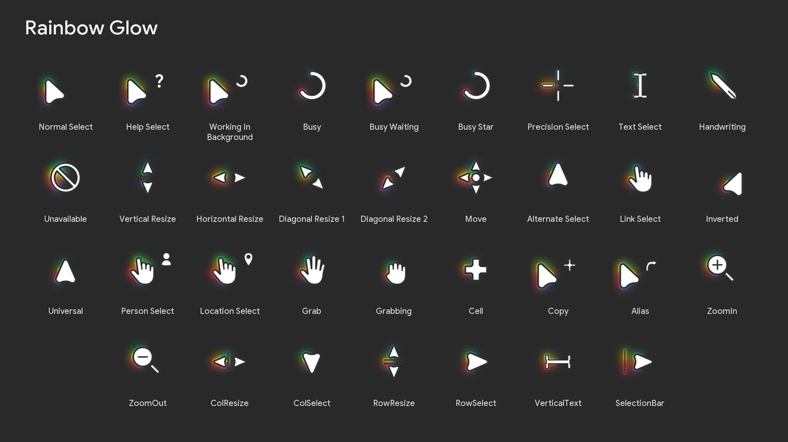
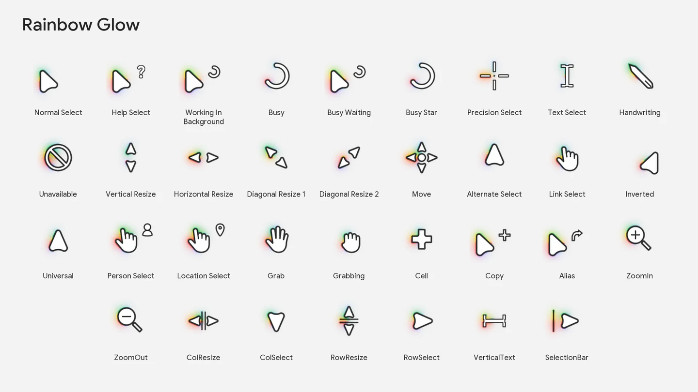

# Rainbow Glow

White cursors, dark contours, flowing rainbow light.

**Windows · 34 animated cursors · INF installer**

<picture>
  <source media="(prefers-color-scheme: light)" srcset="RainbowGlow/preview-light.webp">
  
</picture>

## Install

1. Download the repository (**Code → Download ZIP**) and extract it.
2. Open **RainbowGlow**, then right-click **Install.inf** → **Install**. On Windows 11, open **Show more options** first if needed.
3. Press **Win + R**, run `main.cpl`, then open **Pointers**. Choose **Rainbow Glow** and click **Apply**.

The installer adds the files and registers the scheme; select it in Mouse Properties to activate it.

> **Extra cursors require a compatible [Windhawk](https://windhawk.net/) mod.** The standard Windows scheme assigns 17 system roles; configure the extra `.ani` files in the mod settings.

## Included

34 animated states with a consistent glow, plus loading rings that smoothly accelerate, slow down, stretch and contract. Each cursor includes 32, 40, 48, 64 and 96 px sizes.

Extra states: Grab, Grabbing, Cell, Copy, Alias, ZoomIn, ZoomOut, ColResize, ColSelect, RowResize, RowSelect, VerticalText and SelectionBar.

Preview on a light background

Question-mark shape based on Google Sans. See [third-party notices](RainbowGlow/THIRD_PARTY_NOTICES.md).
